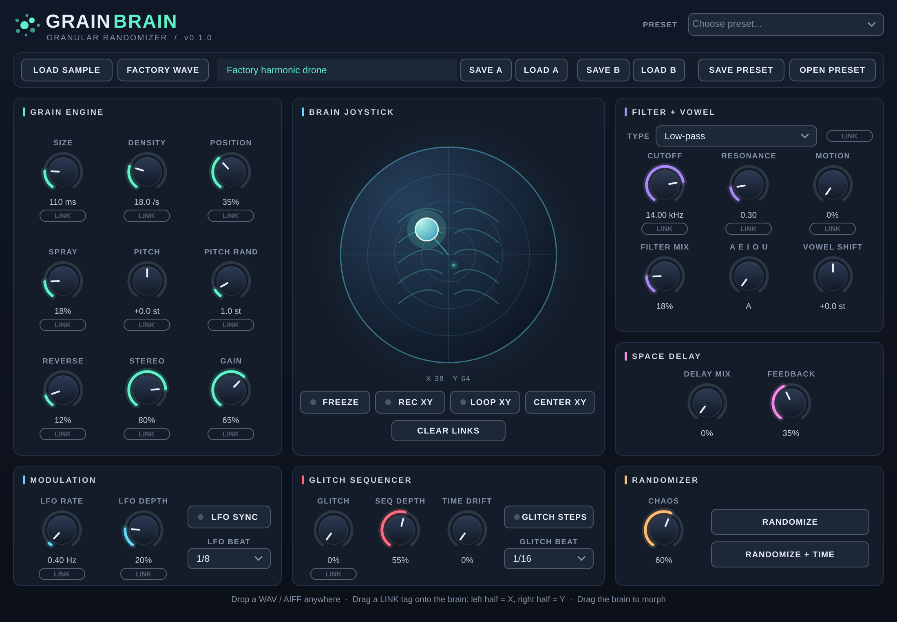
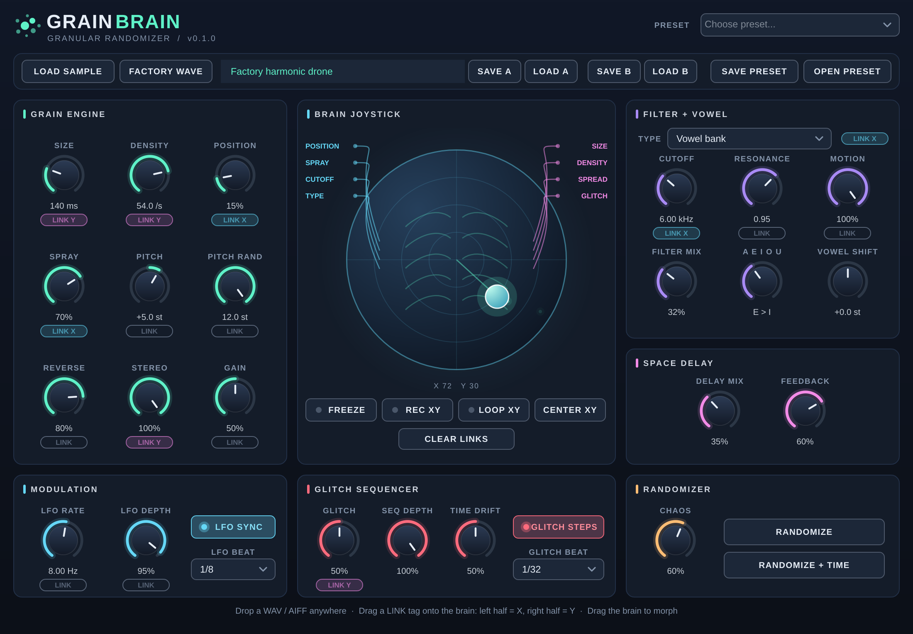

# GrainBrain



## Download for macOS

**[⬇ Download the latest GrainBrain macOS build](https://github.com/noisyloop/grainbrain/actions/workflows/macos.yml)**

Open the newest **successful** workflow run and scroll to **Artifacts**. Download **GrainBrain-macOS** (ZIP), unzip it, then open `GrainBrain-macOS.dmg` or use the included bundles. GitHub may require you to sign in to download workflow artifacts. These are CI test builds, not signed releases.

To install manually, copy `GrainBrain.vst3` to `~/Library/Audio/Plug-Ins/VST3/`, `GrainBrain.component` to `~/Library/Audio/Plug-Ins/Components/`, and `GrainBrain.app` to `/Applications/`. You may need to approve the unsigned app in macOS Privacy & Security.

Experimental granular sample synthesizer for macOS (JUCE 8, C++17).

## Features
- MIDI-triggered grain clouds (16-note pool / 256 overlapping grains)
- Drag-and-drop WAV/AIFF sample loading or built-in harmonic drone
- Grain size, density, position, spray, pitch, pitch randomization, reverse probability, stereo spread and gain
- Sine position LFO with rate and depth
- Five parameter presets: Nebula, Frozen Cloud, Glitch Storm, Deep Space, Tight Pulses
- AU, VST3 and standalone macOS targets

## Screenshots
| Default patch | Joystick links, vowel filter and glitch steps |
| --- | --- |
|  |  |

Screenshots are rendered from the real editor with `tools/screenshots` (see the comment at the top of its `CMakeLists.txt`).

## Build
Requires Xcode, CMake 3.22+ and an internet connection (JUCE is fetched at configure time).

```sh
cmake -S . -B build -G Xcode -DCMAKE_OSX_DEPLOYMENT_TARGET=12.0
cmake --build build --config Release --parallel 3
```

The GitHub Actions workflow builds on macos-15 and uploads a DMG plus the plugin bundles. In the Actions tab, open **macOS Builds** and run the workflow, or push to main.

## Important
This is an experimental MVP, not yet production-ready. User-loaded samples are not embedded in DAW session state; reload them when reopening a session. No Apple Developer signing/notarization is configured, so macOS Gatekeeper may warn. Build status must be verified in GitHub Actions.
